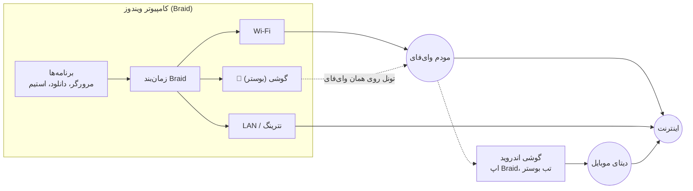

<div dir="rtl">

# Braid (برِید)

**همهٔ اتصال‌های اینترنتتان را با هم استفاده کنید.**
وای‌فای، کابل LAN، تترینگ گوشی و حتی **دیتای موبایل گوشی از طریق همان وای‌فای**، روی ویندوز و اندروید.

[English](README.en.md) · [چطور کار می‌کند](docs/HOW-IT-WORKS.fa.md) · [راهنمای بوستر](docs/BOOSTER.md)

---

## سه حالت کار

| حالت | کجا | چه می‌کند |
|---|---|---|
| **۱. ترکیب روی ویندوز** | آیکن Braid کنار ساعت | Wi‑Fi + LAN + تترینگ USB/هات‌اسپات گوشی را همزمان استفاده می‌کند |
| **۲. ترکیب روی گوشی** | اپ اندروید، تب «ترکیب» | وای‌فای و دیتای موبایل خود گوشی را همزمان استفاده می‌کند |
| **۳. بوستر** | اپ اندروید، تب «بوستر» + منوی Braid در ویندوز | گوشی دیتای موبایلش را **از طریق همان وای‌فای** به کامپیوتر می‌دهد (بدون کابل و بدون هات‌اسپات) و کامپیوتر آن را با وای‌فای خودش جمع می‌کند |



## چه چیزی سریع‌تر می‌شود

Braid **هر اتصال جدید** را به یکی از لینک‌ها می‌دهد؛ لینک سریع‌تر سهم بیشتری می‌گیرد و لینکی که اینترنت ندارد کنار گذاشته می‌شود.

- ✅ دانلود منیجرها (IDM، ADM)، تورنت، آپدیت ویندوز و استیم، بارگذاری صفحه‌های وب، آپلود به فضای ابری
- ❌ یک اتصال تکی (یک ویدیو، یک دانلود بدون چند بخش، بازی آنلاین) سریع‌تر نمی‌شود؛ فقط روی یک لینک می‌ماند و کندتر هم نمی‌شود

## نصب و راه‌اندازی

### ویندوز
1. از صفحهٔ **Actions** این ریپو، آخرین اجرای موفق «Braid» را باز کنید و `braid-windows` را دانلود کنید.
2. `braid-setup-*.exe` را اجرا کنید (یک‌بار اجازهٔ Admin می‌خواهد؛ آداپتور مجازی Wintun نصب می‌شود).
3. آیکن Braid کنار ساعت ظاهر می‌شود. خاکستری = متوقف، کهربایی = فقط یک اتصال، سبز = در حال ترکیب. با نشانک 📱 یعنی گوشی بوستر هم در کار است.

### اندروید (Android 8 به بالا)
1. از همان اجرای Actions، `braid-android` را دانلود کنید و `braid-android.apk` را روی گوشی نصب کنید.
2. **ترکیب**: دکمهٔ بزرگ را بزنید و درخواست VPN را تأیید کنید.
3. **بوستر**: به تب بوستر بروید و دکمه را بزنید؛ وای‌فای و دیتای موبایل هر دو باید روشن باشند.

### جفت کردن گوشی و کامپیوتر (یک‌بار)
1. گوشی و کامپیوتر روی **یک وای‌فای** باشند و بوستر روی گوشی روشن باشد.
2. ویندوز: آیکن Braid › **گوشی‌ها** › نام گوشی › **جفت شدن با این گوشی…**
3. هر دو صفحه یک **کد شش رقمی** نشان می‌دهند. اگر یکسان بود، روی گوشی **تأیید** و روی کامپیوتر **OK** را بزنید.
4. از این به بعد هر وقت بوستر روشن باشد، «📱 نام گوشی» مثل یک لینک معمولی در منوی Braid دیده می‌شود.

جزئیات: [راهنمای بوستر](docs/BOOSTER.md)

## ساختار پروژه

```
braid/
  boost/      پروتکل بوستر (کشف، جفت‌سازی با کد، تونل) — مشترک بین ویندوز و اندروید، فقط کتابخانهٔ استاندارد Go
  desktop/    اپ ویندوز (Go): موتور ترکیب، Wintun، منوی تری فارسی/انگلیسی، نصب‌کننده
  android/    اپ اندروید: Kotlin + Jetpack Compose، موتور Go با gomobile
  docs/       توضیح فنی و راهنما
```

ساخت از سورس: [docs/HOW-IT-WORKS.fa.md](docs/HOW-IT-WORKS.fa.md#ساخت-از-سورس). همهٔ بخش‌ها در GitHub Actions (`.github/workflows/braid.yml`) ساخته و تست می‌شوند.

## محدودیت‌ها
- بوستر در این نسخه فقط **TCP** را از گوشی عبور می‌دهد (همهٔ دانلودها و صفحه‌های وب)؛ UDP (مثلاً QUIC، تماس صوتی) روی لینک‌های خود کامپیوتر می‌ماند.
- در اندروید فقط یک VPN می‌تواند فعال باشد؛ «ترکیب» کنار VPN دیگر کار نمی‌کند. «ترکیب» و «بوستر» هم همزمان روشن نمی‌شوند.
- تا وقتی «ترکیب» یا «بوستر» روشن است دیتای موبایل مصرف می‌شود.

## مجوز
MIT. بر پایهٔ [net-merge](https://github.com/net-merge/net-merge) از Rohit Mahto و [نسخهٔ اندرویدی](https://github.com/net-merge/android) آن (هر دو MIT). فونت اپ: [وزیرمتن](https://github.com/rastikerdar/vazirmatn) (SIL OFL).

</div>
