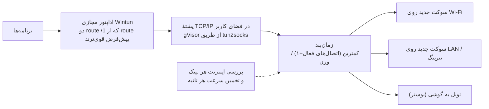
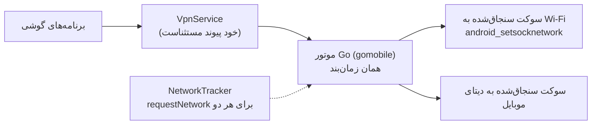
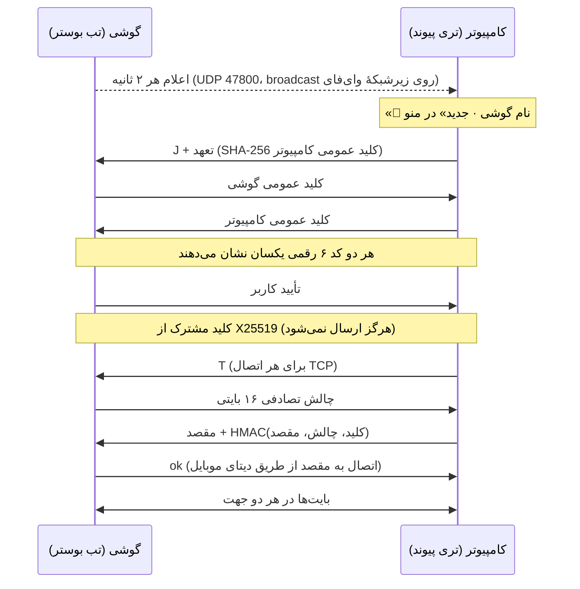

# پیوند چطور کار می‌کند

## ۱. ترکیب روی ویندوز

1. وقتی ترکیب روشن می‌شود، پیوند آداپتور مجازی `peyvand` (Wintun) و دو route ‎`0.0.0.0/1` و ‎`128.0.0.0/1` می‌سازد که از route پیش‌فرض دقیق‌ترند، بدون اینکه به آن دست بزنند.
2. هر اتصال برنامه‌ها داخل پشتهٔ TCP/IP خود پیوند تمام می‌شود و پیوند یک اتصال تازه به سرور واقعی از لینک انتخاب‌شده باز می‌کند (سوکت با `IP_UNICAST_IF` به همان آداپتور سنجاق می‌شود تا دوباره وارد آداپتور مجازی نشود) و بایت‌ها را بین این دو کپی می‌کند.
3. زمان‌بند لینکی را انتخاب می‌کند که «(اتصال‌های فعال + ۱) ÷ وزن» کمترینش باشد؛ وزن هر ثانیه از سرعت واقعی‌ای که آن لینک جابه‌جا کرده به‌روز می‌شود.
4. هر لینک مدام با یک اتصال کوتاه به ‎`1.1.1.1:443` آزمایش می‌شود؛ لینکی که اینترنت ندارد (مثلاً وای‌فای با صفحهٔ ورود) اتصال جدید نمی‌گیرد تا وقتی برگردد.
5. اگر پیوند کرش کند، آداپتور و routeها با خود پروسه از بین می‌روند؛ اینترنت قطع نمی‌شود.

## ۲. ترکیب روی گوشی

اندروید معمولاً وقتی وای‌فای وصل است دیتای موبایل را قطع می‌کند؛ پیوند با `requestNetwork` هر دو را زنده نگه می‌دارد، ترافیک را با یک VPN محلی می‌گیرد و هر اتصال را روی یکی از دو شبکه می‌فرستد. هیچ سرور واسطی وجود ندارد.

## ۳. بوستر

- سرویس گوشی روی TCP 47801 و فقط برای آدرس‌های زیرشبکهٔ وای‌فای خودش جواب می‌دهد و هر اتصال خروجی را **فقط** به دیتای موبایل سنجاق می‌کند.
- در کامپیوتر، هر گوشی جفت‌شده و آنلاین یک «لینک دور» در زمان‌بند است: probe، وزن، دورهٔ استراحت بعد از خطا و سقف سرعت مثل یک آداپتور معمولی. ترافیک تونل روی وای‌فای از آمار وای‌فای کم می‌شود تا دوبار شمرده نشود.
- UDP از گوشی عبور نمی‌کند (نسخهٔ اول)؛ روی لینک‌های محلی می‌ماند.

## ساخت از سورس

| بخش | دستور |
|---|---|
| پروتکل بوستر | `cd boost && go test ./...` |
| ویندوز (روی ویندوز، با Go و Inno Setup 6) | `cd desktop && scripts\build.ps1 -Version 0.1.0` → `dist\` |
| ویندوز (کامپایل متقابل از لینوکس) | `cd desktop && GOOS=windows go build ./cmd/peyvand` |
| تست‌های دسکتاپ | `cd desktop && go test ./...` |
| اندروید (Go + Android SDK + NDK + JDK 17) | `cd android && ./scripts/build-go.sh && ./gradlew assembleDebug` |

همهٔ این‌ها در `.github/workflows/peyvand.yml` روی هر push اجرا می‌شوند و خروجی‌ها (نصب‌کنندهٔ ویندوز، zip قابل‌حمل، APK) در بخش Artifacts همان اجرا قرار می‌گیرند.

## فایل‌های کلیدی

| فایل | نقش |
|---|---|
| `boost/pair.go` | جفت‌سازی با مقایسهٔ کد (X25519 + تعهد) |
| `boost/tunnel.go`، `boost/server.go` | تونل احرازشده با HMAC و سرور سمت گوشی |
| `boost/announce.go` | اعلام و کشف گوشی‌ها روی وای‌فای |
| `desktop/internal/engine/` | زمان‌بند، balancer، probe؛ پشتیبانی از «لینک دور» |
| `desktop/internal/booster/` | گوشی‌های جفت‌شده، ذخیرهٔ کلید با DPAPI، تبدیل گوشی به لینک |
| `desktop/internal/tray/` | منوی تری، آیکن وضعیت، فارسی/انگلیسی |
| `desktop/internal/i18n/` | متن‌های فارسی و انگلیسی تری |
| `android/golib/peyvand/` | API موتور برای Kotlin (ترکیب + بوستر) |
| `android/app/.../BoostService.kt` | سرویس بوستر، اعلان تأیید جفت‌سازی |
| `android/app/.../ui/` | صفحه‌های Compose: ترکیب، بوستر، تنظیمات |

